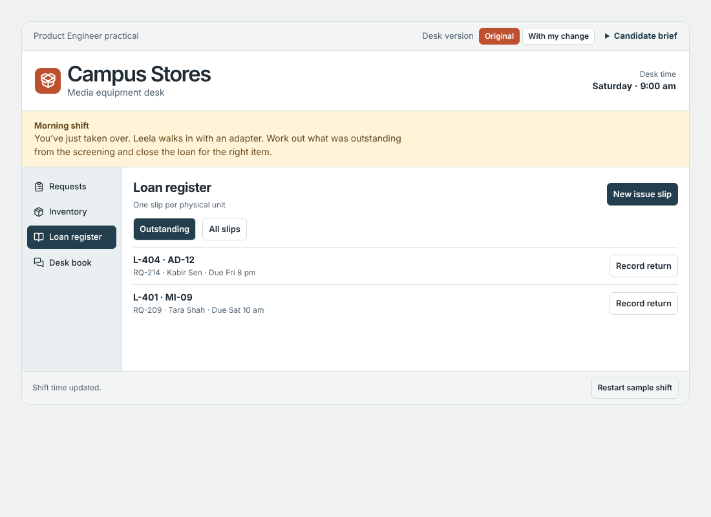
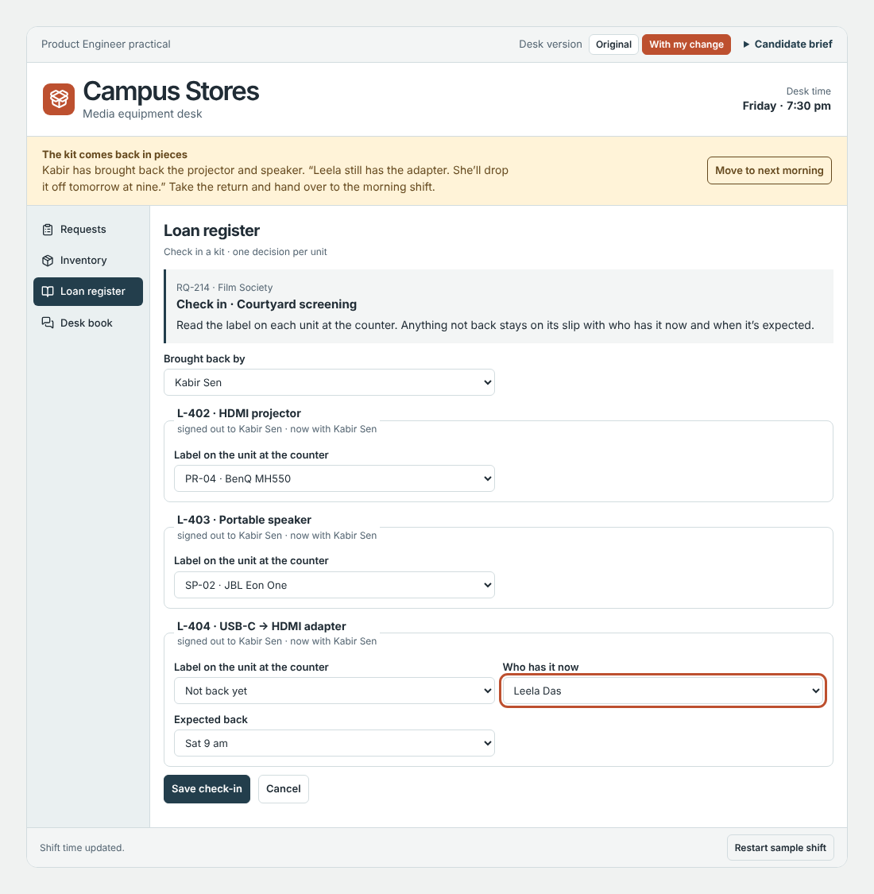
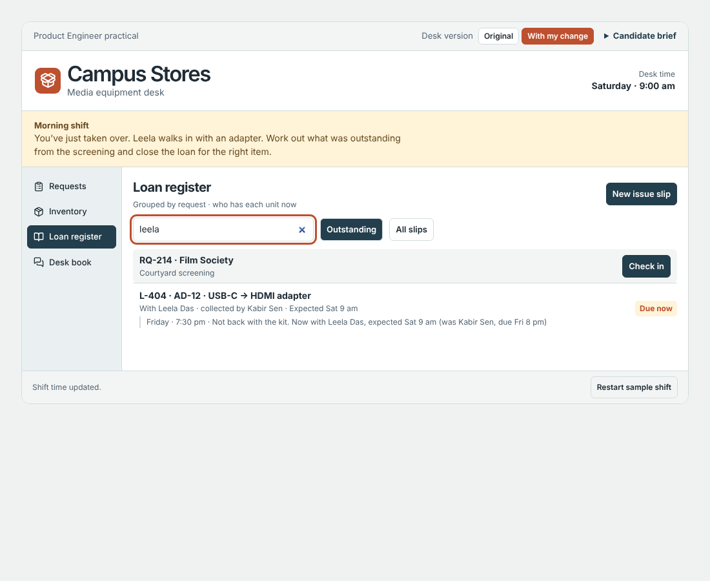
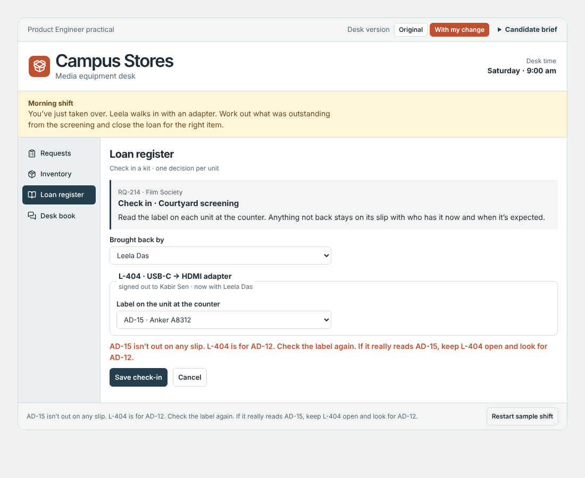

# Campus Stores

Campus Stores is a Product Engineer work sample set at a fictional campus media equipment desk. Work through a club’s screening, from equipment pickup to a partial return and the next morning’s handover. Open **Candidate brief** in the app for the assignment.

---

## My submission

**To review:** open `index.html`. The top strip has a **Desk version** switch: **Original** and **With my change**. Both versions read and write the same records, so you can do the 3:45 pm pickup on one and switch mid-shift. The app opens on **With my change**, and **Restart sample shift** keeps whichever version you're on.

**My decision:** keep the desk's issue rules and its one-slip-per-unit register. Change how things come *back*. In the original, a return is a one-click action on a single slip. In my version you **check in the kit**, and the slip holds the whole story: who has each unit now, when it's expected, and that someone actually read the label on the unit being handed in.

### The moment the product handles well: Friday 3:45 pm, pickup

I issued the Film Society kit to Kabir as three slips: L-402 PR-04 projector, L-403 SP-02 speaker, L-404 AD-12 adapter. The issue form stopped me from making the mistakes a rushed counter makes:

- **PR-06 never appears** in "Unit leaving the desk" because it's in the workshop. I couldn't have handed Kabir a broken projector four minutes before a screening.
- After SP-02, I tried to add **SP-05 against RQ-214** and got *"The approved quantity of this equipment type is already on loan."* Equipment that isn't on the approved form is refused the same way.
- **One slip per physical unit** is what makes the 7:30 pm return possible at all. I closed L-402 and L-403 and left L-404 open, so the record stayed true when the kit came back in pieces.

I kept all of this unchanged.

### The moment I'd change: Friday 7:30 pm → Saturday 9:00 am, the adapter

At 7:30 Kabir returned the projector and speaker and told me Leela had the adapter until 9 am. In the original desk, I clicked **Record return** twice and then had nowhere to put the rest of what he'd said except a free-text note in the **Desk book**. L-404 still read *"RQ-214 · Kabir Sen · Due Fri 8 pm"*.



That's what the morning shift inherits (above). At Saturday 9 am:

1. **Leela's name isn't on any loan.** To link "Leela with an adapter" to L-404, the morning clerk has to find Kabir's message or my note in the desk book, work out that "our adapter" means RQ-214, and then match that to L-404.
2. **Nothing says L-404 is 13 hours late.** "Due Fri 8 pm" looks the same as Tara's mic, which isn't due until 10 am.
3. **Record return never asks what's in your hand.** Bin C4 holds two identical USB-C → HDMI adapters, AD-12 and AD-15. If someone at 3:45 picked AD-12 in the dropdown but handed over AD-15 from the bin, the morning clerk closes AD-12's slip, Inventory shows both adapters on the shelf, and the mistake is now invisible. The same single click on the wrong row would also close Tara's loan, with no undo.

The register knows *which* unit left. It loses track of *where* it is and never checks *what* came back.

### My change: check in the kit, not the slip

Built into `app.js`/`styles.css` behind the **With my change** switch:

- **Register grouped by request** ("RQ-214 · Film Society"), with each unit's type shown next to its ID, so "the projector and speaker" maps to rows at a glance.
- **Check in** opens one form for the whole kit. For each open slip, the clerk picks the **label on the unit at the counter** from the units of that type (for example AD-12 · Belkin or AD-15 · Anker), or chooses **Not back yet**.
  - **Not back yet** requires **who has it now** and **when it's expected**. The slip keeps Kabir as the person who signed it out and records Leela as the current holder, with a dated history line.
  - **The wrong label blocks the save** and explains what to do, for example *"AD-15 isn't out on any slip. L-404 is for AD-12. Check the label again…"*. Nothing is saved until every unit checks out, so a kit is never left half checked in.
- **Saving writes the handover for you.** A desk book entry ("Still out: AD-12 … with Leela Das, expected Sat 9 am (slip L-404)") is generated from the record. Free-text notes are still there for anything else.
- **Desk time drives "Due now" / "Overdue" tags.** The register can be searched by person, unit or request.
- **The request form shows kit status** per approved item: returned, with whom, or not issued.

### The same job with my change

| Time | What I do | What the desk now knows |
|---|---|---|
| Fri 3:45 pm | Issue PR-04, SP-02, AD-12 to Kabir (unchanged) | Three slips under RQ-214 |
| Fri 7:30 pm | RQ-214 → **Check in**. Brought back by Kabir. PR-04 ✓, SP-02 ✓, adapter **Not back yet → Leela Das, Sat 9 am** | L-402/403 closed with the labels checked. L-404 reads "With Leela Das · collected by Kabir Sen · Expected Sat 9 am", and the handover is written automatically |
| Sat 9:00 am | Type "leela" in the register. One row: L-404 AD-12, **Due now**. **Check in**, pick the label on what she's holding | If it reads AD-12, the loan closes and RQ-214 shows complete. If it reads AD-15, the clerk is stopped before closing the wrong slip |





The morning clerk never has to open the desk book to work out which loan Leela belongs to.

### What I kept, and what I deliberately didn't build

**Kept:** the issue form and all its checks, one slip per unit, the desk book for messages from clubs, the shift/time model and the storage format. The new fields (`holder`, `log`, note `author`) are optional, so older saved shifts still load. The original desk remains selectable and behaves exactly as before.

**Not built:** barcode scanning (the label select stands in for it), undo, and pre-filling the due time from the request. All three are reasonable next steps. I left them out to keep the change about one moment.

### One observation at a real counter

When a late item comes back on the morning after a partial return, **watch whether the clerk can close the right slip from the loan register alone, without opening the desk book or asking anyone who it belongs to.** Over the first two weeks, I'd count those returns and how many needed the desk book or a question. If my change helps, that count should drop to near zero. If clerks still go to the desk book first, then the custody line on the slip isn't where they look, and the grouping or search is the part to fix.

### Files I changed

- `app.js`: check-in flow, custody/expected time on slips, overdue tags, search, kit status, Desk version switch
- `styles.css`: styles for the new parts (desktop and mobile)
- `index.html`: mount point for the Desk version switch
- `docs/*.png`: screenshots from a scripted run of the shift

I used an AI assistant (Claude) while building and writing this, which the brief allows.

---

## Run the app

Open `index.html` in a modern browser. The app includes its scripts, styles, and icons and can run offline.

To serve it over local HTTP, run this from the repository folder and visit `http://localhost:8000`.

```sh
python3 -m http.server 8000 --bind 127.0.0.1
```

Each browser stores its own sample shift locally when browser storage is available. **Restart sample shift** restores the fictional starting records.

## Source

- `index.html` contains the desk layout, candidate brief, and bundled icons.
- `app.js` contains the sample records and interactions.
- `styles.css` defines the desktop and mobile layouts.

Icon license notices are in [third-party/lucide-LICENSE.txt](third-party/lucide-LICENSE.txt).


## Submit your work

1. [Fork Campus Stores](https://github.com/virinchi-healthcare/campus-stores/fork) into your GitHub account. Complete the candidate brief and push your changes to your public fork. In your README, point reviewers to your work and explain the decision you made.
2. In your fork, open **Commits**, select the final commit you want reviewed, and copy the page URL. It should look like `https://github.com/YOUR-USERNAME/campus-stores/commit/COMMIT-SHA`.
3. [Submit your work through the Google Form](https://docs.google.com/forms/d/e/1FAIpQLScvzoh1R4WS-SkiwAVBQbMvniieJYSoOEfLMyVo5CyjOvYUgQ/viewform). Your **roll number**, **email ID**, and **final commit link from your public fork** are required. Enter your roll number and email ID in the form only.
